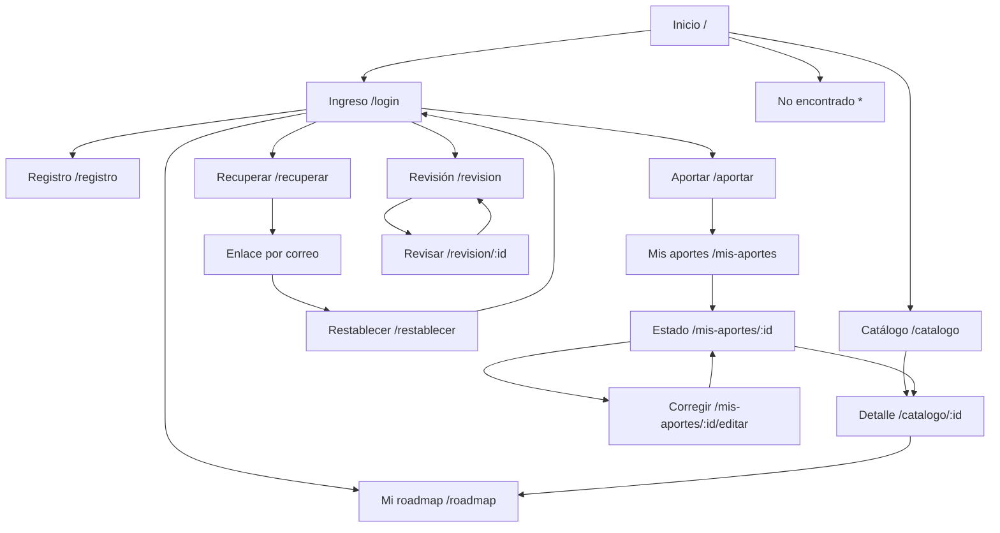

# APPFlow — SaberColectivo

Navegación del MVP. Estados y tokens: UX-UI. Contratos: BackendSchema §3. Fecha: 27/10/2026. Gestión de publicados pendiente Q-06; no se agrega un flujo de edición administrativa sin confirmación.

## 1. Sitemap

Las aristas de login indican destinos autorizados según sesión/rol, no que el visitante deba iniciar sesión para explorar. Header enlaza a las secciones autorizadas desde todas las pantallas.

## 2. Rutas

| Ruta | Pantalla | Requiere login | Notas |
|---|---|---|---|
| / | Inicio | No | Propuesta de valor y CTA al catálogo/aporte |
| /catalogo | Catálogo | No | q,categoria_id,page en query de navegación |
| /catalogo/:id | Detalle | No | Solo publicado |
| /registro | Registro | No | Tras alta va a login |
| /login | Ingreso | No | returnTo interno validado |
| /recuperar | Solicitud de recuperación | No | Mensaje genérico |
| /restablecer | Nueva contraseña | No | Fragmento token retirado tras leer |
| /roadmap | Mi roadmap | Sí | Privado y paginado |
| /aportar | Nuevo aporte | Sí | Todos los metadatos |
| /mis-aportes | Mis aportes | Sí | Lista paginada del autor |
| /mis-aportes/:id | Estado e historial | Sí, autor | Estado, motivo e historial paginado |
| /mis-aportes/:id/editar | Corregir rechazado | Sí, autor | Guardar y después reenviar |
| /revision | Cola pendiente | Sí, administrador | Paginada |
| /revision/:id | Revisión de aporte | Sí, administrador | Aprobar/rechazar |
| * | No encontrado | No | Incluye rutas desconocidas; enlace al catálogo |

No hay ruta pública de perfil o de roadmap ajeno. /revision visible solo a administrador; ocultar menú no sustituye control de API. Páginas de acceso con sesión activa redirigen a /roadmap, salvo /restablecer que puede consumirse sin usar una sesión previa.

## 3. Fichas de pantalla

Todas comparten header, enlace saltar al contenido y un h1. Shell consulta `GET /api/v1/auth/me` una vez al iniciar y tras cambios de sesión; 401 indica visitante. Loading de sesión no muestra datos privados hasta resolver. Formularios no conservan contraseña/token después de envío exitoso. Las APIs siguientes existen en BackendSchema §3.

### Inicio (/)

- **Objetivo:** entender SaberColectivo: el conocimiento crece cuando se comparte.
- **Componentes:** header, bloque de texto, botones «Explorar catálogo» y «Aportar curso».
- **Estados:** contenido estático disponible; shell puede cargar sesión o informar fallo de red.
- **APIs:** ninguna propia, no carga listados parciales sin paginación.
- **Navegación:** catálogo; aportar con login y retorno si visitante.

### Catálogo (/catalogo)

- **Objetivo:** encontrar cursos por palabras clave y categoría.
- **Componentes:** búsqueda, selector de categoría, cards, paginador, skeleton/empty/error.
- **Estados:** loading, resultados, vacío total, sin coincidencias, error con Reintentar.
- **APIs:** `GET /api/v1/cursos` con page,page_size,q,categoria_id; `GET /api/v1/categorias` paginado.
- **Navegación:** detalle; aportar; cambios de filtros reinician page=1; atrás restaura query. No se marca «En mi roadmap» masivamente sin evidencia de la API; el conflicto al agregar informa que ya está incluido.

### Detalle de curso (/catalogo/:id)

- **Objetivo:** comparar metadatos, gratuidad y certificado del proveedor antes de elegir.
- **Componentes:** detalle, badges textuales, enlace externo y botón agregar.
- **Estados:** loading, disponible, no encontrado, error recuperable; agregando, agregado, duplicado.
- **APIs:** `GET /api/v1/cursos/{id}`; `POST /api/v1/roadmap/items` con curso_id.
- **Navegación:** volver al catálogo conservando filtros; «Ir al curso» abre proveedor en pestaña nueva con rel=noopener noreferrer y texto «Sitio del proveedor»; visitante al agregar va a login con retorno al detalle, sin alta automática al volver.

### Registro (/registro)

- **Objetivo:** crear cuenta de usuario.
- **Componentes:** nombre, email, contraseña y confirmación local, ayuda de 12–128 caracteres.
- **Estados:** editable, errores inline/resumen, enviando, correo en uso, límite temporal, éxito.
- **APIs:** `POST /api/v1/auth/registro`; confirmación no viaja al backend.
- **Navegación:** éxito → login con aviso; conserva returnTo seguro, no contraseña. Ir a login sin registrarse.

### Ingreso (/login)

- **Objetivo:** abrir sesión.
- **Componentes:** email, contraseña, botón ingresar, enlace recuperar/registro.
- **Estados:** listo, enviando, credenciales inválidas genéricas, 429 con espera según Retry-After, red fallida, éxito.
- **APIs:** `POST /api/v1/auth/login`; guarda usuario/CSRF solo en memoria y cookie gestionada por navegador.
- **Navegación:** returnTo relativo interno permitido o /roadmap; nunca aceptar URL externa ni //host. Mostrar campos vacíos al volver tras logout.

### Recuperar (/recuperar)

- **Objetivo:** pedir instrucciones sin revelar si hay cuenta.
- **Componentes:** email, botón enviar y confirmación genérica persistente.
- **Estados:** editable, enviando, 202 genérico, formato inválido, límite IP, error de red.
- **APIs:** `POST /api/v1/auth/recuperar`.
- **Navegación:** volver a login o pedir nuevo enlace tras espera; en dev bandeja Mailpit :8025 mediante instrucciones de desarrollo, no como enlace de producto.

### Restablecer (/restablecer)

- **Objetivo:** establecer nueva contraseña desde enlace de correo.
- **Componentes:** nueva contraseña y confirmación, ayuda, botón guardar.
- **Estados:** fragmento ausente → mensaje con enlace recuperar; editable con token en memoria; enviando; token inválido/vencido/usado; error de campos; éxito.
- **APIs:** `POST /api/v1/auth/restablecer` con token y password; no GET de token.
- **Navegación:** leer fragmento, retirarlo con reemplazo de historial; al éxito descartar token, limpiar sesión y volver a login. Si recarga después de limpiar fragmento debe pedir enlace nuevo; se explica en pantalla. No se inicia sesión automáticamente.

### Mi roadmap (/roadmap)

- **Objetivo:** planificar orden y avance personal.
- **Componentes:** lista/cards o tabla, estado select, subir/bajar/mover al final, confirmación de quitar, paginador.
- **Estados:** loading, lista, vacío con catálogo, error, guardando por ítem, conflicto/ítem no disponible.
- **APIs:** `GET /api/v1/roadmap`; `PATCH /api/v1/roadmap/items/{id}`; `POST /api/v1/roadmap/items/{id}/mover`; `DELETE /api/v1/roadmap/items/{id}`.
- **Navegación:** detalle público del curso; catálogo; tras cambio de orden recargar página actual; al quitar último de página >1 volver a anterior. Para subir primer ítem de página consultar página anterior con GET roadmap y mover antes de su último ítem; para bajar último consultar página siguiente y mover antes del segundo ítem siguiente, o null si solo hay uno. Mantener page_size para esas consultas. Mostrar aviso si otro cambio modificó vecinos y recargar antes de repetir. No requiere cargar colección completa.

### Aportar curso (/aportar)

- **Objetivo:** presentar metadatos y declaración de toma para revisión.
- **Componentes:** formulario CursoInput, docentes repetibles, booleanos Sí/No, categorías paginadas, ayuda sobre contenido gratuito y certificado pago opcional.
- **Estados:** cargando categorías, editable, errores de campos, duplicado, enviando, éxito y error de red.
- **APIs:** `GET /api/v1/categorias`; `POST /api/v1/aportes`.
- **Navegación:** éxito → /mis-aportes/:id; cancelar → mis aportes. No hay guardado persistente de borrador; confirmar salida si hay cambios locales sin enviar.

### Mis aportes (/mis-aportes)

- **Objetivo:** encontrar envíos y su estado.
- **Componentes:** lista/tabla paginada, badges textuales, CTA aportar.
- **Estados:** loading, lista, vacío, error.
- **APIs:** `GET /api/v1/aportes` solo propios.
- **Navegación:** estado del aporte, aportar, catálogo.

### Estado e historial (/mis-aportes/:id)

- **Objetivo:** entender qué ocurrió y corregir si fue rechazado.
- **Componentes:** detalle, estado, último motivo, historial paginado, botón corregir/reenviar condicionado.
- **Estados:** loading, en_revision sin edición, rechazado corregible, publicado con enlace público, 404 ajeno, error y reenviando.
- **APIs:** `GET /api/v1/aportes/{id}`; `GET /api/v1/aportes/{id}/eventos`; `POST /api/v1/aportes/{id}/reenviar` con revision actual.
- **Navegación:** corregir si rechazado; reenviar exige confirmación de que datos están corregidos; 409 relee y explica cambio; publicado → catálogo/:id.

### Corregir rechazado (/mis-aportes/:id/editar)

- **Objetivo:** subsanar el motivo antes de volver a revisión.
- **Componentes:** formulario precargado, motivo visible, botones guardar y volver.
- **Estados:** loading, editable solo rechazado, validación, guardando, guardado, 409 con recarga sin sobrescribir silenciosamente, 404 ajeno.
- **APIs:** `GET /api/v1/aportes/{id}`; `GET /api/v1/categorias`; `PUT /api/v1/aportes/{id}` con CursoInput y revision.
- **Navegación:** guardar → estado con aviso «Corrección guardada; falta reenviar»; no cambia estado automáticamente. Si no está rechazado vuelve al estado con explicación. Al salir con cambios confirmar descarte.

### Cola de revisión (/revision)

- **Objetivo:** atender aportes pendientes por orden de llegada.
- **Componentes:** lista/tabla paginada, estado de cola vacía.
- **Estados:** loading, pendientes, vacío, error, 403.
- **APIs:** `GET /api/v1/revision/aportes`.
- **Navegación:** revisar ítem; acceso denegado muestra mensaje en misma ruta y enlace a catálogo, sin bucle de login para usuario sin rol.

### Revisar aporte (/revision/:id)

- **Objetivo:** comprobar enlace y condiciones y registrar decisión motivada.
- **Componentes:** metadatos, declaración de toma, enlace proveedor, checklist visual, historial paginado, radios aprobar/rechazar y motivo.
- **Estados:** loading, revisable, enviando, rechazo sin motivo, ya resuelto/conflicto, 403/404, error recuperable.
- **APIs:** `GET /api/v1/aportes/{id}`; `GET /api/v1/aportes/{id}/eventos`; `POST /api/v1/aportes/{id}/validar` con aprobado,motivo,revision.
- **Navegación:** completar revisión manual antes de aprobar; éxito vuelve a cola; 409 relee estado. Aprobación propia pendiente Q-05; no se presenta aún como prohibida o permitida definitivamente.

### No encontrado (*)

- **Objetivo:** recuperar navegación ante ruta o recurso inexistente.
- **Componentes:** mensaje claro, enlace catálogo/inicio.
- **Estados:** estático; 404 de recurso conserva contexto y opción volver.
- **APIs:** ninguna propia.
- **Navegación:** inicio o catálogo. Sin datos del recurso oculto.

## 4. Flujos de usuario (mínimo 3)

### Flujo 1 — Aportar y consultar resultado (US-004)

1. Usuario entra a aportar; visitante ingresa y retorna a esa ruta.
2. Carga URL, categoría principal, tema, título, versión, año, docentes, respuestas sobre cuestionarios/examen/certificado/aval, organización si aplica, costo de certificado y si lo tomó.
3. UI valida obligatoriedad sin inferir respuestas booleanas; API valida de nuevo.
4. POST aportes → 201 en_revision; redirige al estado propio y avisa que no es público todavía.
5. Error 422 asocia campos; 409 de URL informa sin revelar un aporte ajeno; error de red conserva campos, permite consultar mis aportes antes de repetir un envío de resultado incierto.
6. Autor consulta listado y estado/historial paginados; nunca ve aportes de terceros.

### Flujo 2 — Descubrir y planificar (US-001, US-007, US-008)

1. Visitante busca por palabras y filtra una de las diez categorías; cada cambio vuelve a página 1.
2. Abre detalle publicado; ve condiciones de certificado y proveedor externo.
3. Agregar exige sesión; al regresar de login debe confirmar agregar, evitando mutación por GET o redirección.
4. POST roadmap → 201 pendiente al final; 409 muestra «Ya está en tu roadmap» y ofrece abrirlo.
5. En roadmap cambia estado y orden con controles de teclado; puede cruzar páginas sin perder ítems.
6. Quitar abre confirmación; cancelar no modifica; confirmar DELETE y refresca total/página.
7. Error de red deja estado previo visible con aviso; releer antes de dar por fallida una escritura incierta. Otro usuario recibe 404 al intentar modificar ese ítem.

### Flujo 3 — Rechazar, corregir y aprobar (US-005, US-006)

1. Administrador abre cola paginada y elige pendiente; usuario sin rol recibe 403.
2. Abre proveedor, comprueba enlace activo y contenido completamente gratuito, sin prueba temporal, y coherencia de metadatos.
3. Si falla, rechaza con motivo; sin motivo 422 y conserva formulario. Si no puede verificar, no aprueba por suposición.
4. Autor ve rechazo, abre corrección, guarda mediante PUT conservando rechazado e historial.
5. Autor reenvía → en_revision; aparece nuevamente en cola, aún no en catálogo.
6. Administrador aprueba → publicado; catálogo y detalle públicos ya lo muestran.
7. Si otro administrador resolvió primero, 409 obliga a actualizar; ningún evento previo se sobrescribe. Regla de revisión propia pendiente Q-05.

### Flujo 4 — Registro, ingreso y salida (US-002)

1. Visitante completa registro; API crea usuario, nunca administrador, y deriva a login.
2. Login válido fija cookie y devuelve usuario/CSRF; returnTo debe ser interno.
3. Credenciales incorrectas muestran mensaje uniforme; 429 bloquea nuevos intentos de UI durante Retry-After, sin confiar en UI como control de seguridad.
4. Salir hace `POST /api/v1/auth/logout` con CSRF, revoca sesión, borra estado en memoria y navega a catálogo. Si ya expiró, limpia estado local igualmente.

### Flujo 5 — Recuperación completa (US-003)

1. Desde login solicita recuperación con email; respuesta genérica independientemente de existencia.
2. Cuenta existente recibe enlace SMTP; en dev se inspecciona bandeja local fuera de la UI de producto.
3. Abre restablecer con fragmento token; UI lo retira del historial y pide nueva contraseña y confirmación.
4. POST restablecer válido consume token, cambia hash e invalida sesiones; redirige a login sin sesión automática.
5. Ingreso con nueva contraseña funciona; anterior falla. Reutilizar enlace, abrir vencido o token inválido produce mismo error y CTA para nuevo enlace.
6. Fallo de envío se registra sin secreto; usuario puede pedir nuevo enlace. Error de red al confirmar invita a intentar login o solicitar nuevo enlace, pues el token pudo consumirse.

## 5. Estados globales de la app

| Situación | Comportamiento |
|---|---|
| Sin sesión en ruta protegida | Login con returnTo interno validado; sin render de datos privados. |
| Sesión expirada (401) | Limpiar sesión y CSRF; mensaje y retorno a login. Mantener solo datos no secretos del formulario en memoria de la pestaña, descartados al cerrar. |
| 403 rol insuficiente | Mensaje acceso denegado y enlace al catálogo; no reintentar login en bucle. |
| 403 CSRF | Reconsultar auth/me; no repetir automáticamente una escritura; usuario confirma nuevo intento. |
| Error de red/500 | Banner persistente, reintentar lecturas; escrituras inciertas se releen antes de duplicar. |
| 409 de revisión | Explicar cambio y obtener versión actual; conservar texto local para copiar, sin sobrescribir nuevo estado. |
| 429 | Mensaje con espera Retry-After; controles de envío deshabilitados hasta plazo; navegación permanece usable. |
| 404 privado | No distinguir inexistente de ajeno; mensaje no encontrado. |
| Cambios locales sin guardar | Confirmación de descarte al navegar fuera de formularios de aporte/corrección. |
