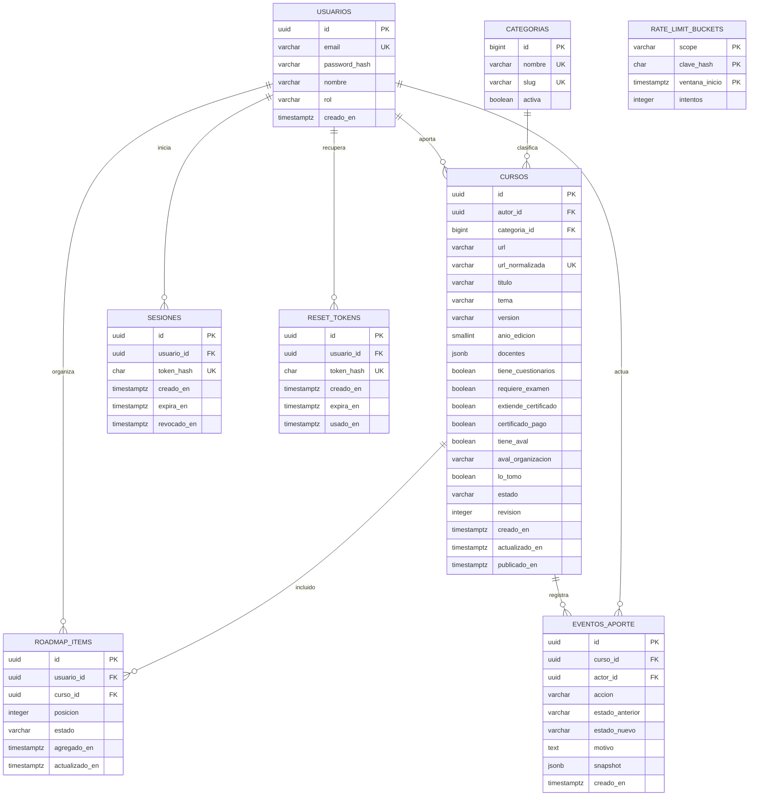
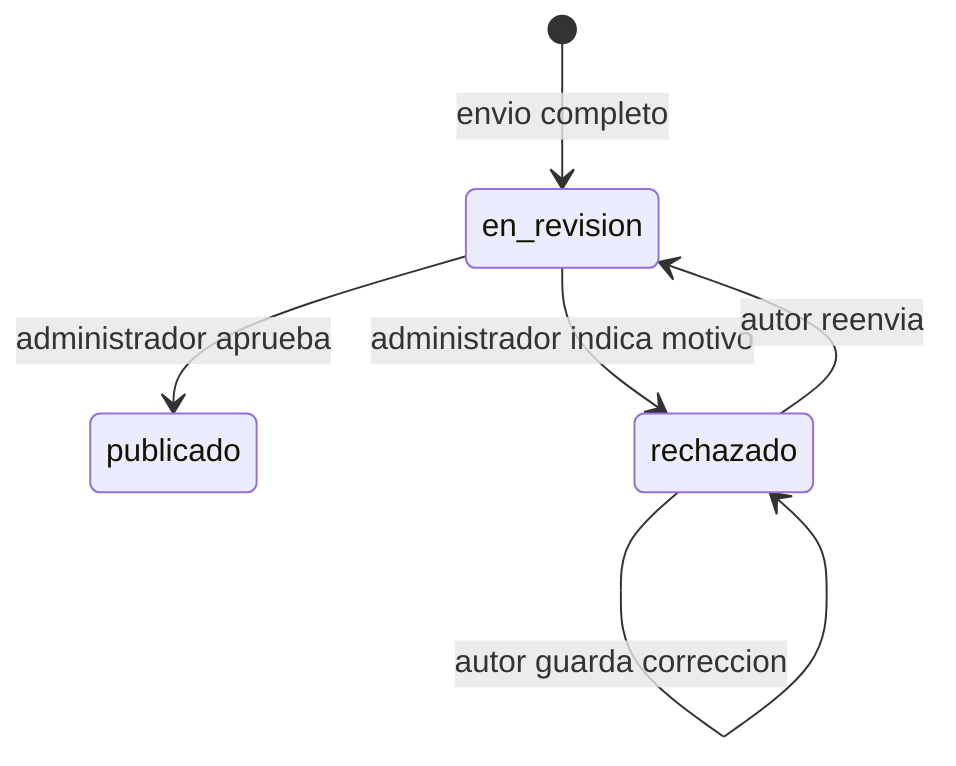

# BackendSchema — SaberColectivo

Contrato diseñado para PostgreSQL 18.6; sin migraciones ni backend creados. Fecha: 27/10/2026. Q-04 (unicidad URL), Q-05 (autor administrador) y Q-06 (gestión de publicados) permanecen propuestas hasta respuesta del autor. El contrato base documenta unicidad por URL y ciclo hasta publicación; no habilita por sí solo decisiones pendientes.

## 1. Modelo de datos

### 1.1 Diagrama entidad-relación



No hay tabla roadmap: la colección de items por usuario representa su único roadmap. Aporte y curso son una entidad en distintos estados; autor_id y eventos conservan su procedencia, evitando sincronizar dos copias de los metadatos. RATE_LIMIT_BUCKETS no tiene FK a usuario: limita también identidades inexistentes sin revelar existencia.

### 1.2 Tablas (una por entidad)

Convenciones: UUID generado en servidor; todas las fechas timestamptz UTC; NOT NULL salvo indicación; FK ON DELETE RESTRICT salvo política explícita. No se incluye borrado de cuentas ni de cursos en MVP.

#### usuarios

| Columna | Tipo | Constraints | Notas |
|---|---|---|---|
| id | uuid | PK | Generado en servidor |
| email | varchar(254) | UNIQUE, NOT NULL | Trim y minúsculas antes de persistir; DB CHECK email=lower(btrim(email)) |
| password_hash | text | NOT NULL | Argon2id; nunca serializar |
| nombre | varchar(100) | NOT NULL, longitud 1–100 tras trim | Nombre visible |
| rol | varchar(20) | CHECK usuario/administrador, default usuario | Registro no acepta rol |
| creado_en | timestamptz | default now() | Fecha alta |

Índices: PK y UNIQUE email cubren login. Lock de esta fila serializa reordenamientos del roadmap y reset de contraseña.

#### categorias

| Columna | Tipo | Constraints | Notas |
|---|---|---|---|
| id | bigint GENERATED ALWAYS AS IDENTITY | PK | No depender de un número en frontend |
| nombre | varchar(100) | UNIQUE, longitud 1–100 | Etiqueta visible |
| slug | varchar(100) | UNIQUE, patrón [a-z0-9-]+ | Clave estable del seed |
| activa | boolean | default true | Nuevos aportes solo en activas |

Seed inicial idempotente por slug, diez registros: tecnologia-programacion → Tecnología y Programación; negocios-administracion → Negocios y Administración; ciencias-matematicas → Ciencias y Matemáticas; idiomas → Idiomas; arte-diseno → Arte y Diseño; humanidades-ciencias-sociales → Humanidades y Ciencias Sociales; oficios-formacion-tecnica → Oficios y Formación Técnica; comunicacion-marketing → Comunicación y Marketing; desarrollo-personal-profesional → Desarrollo Personal y Profesional; salud-bienestar → Salud y Bienestar. Agregar categorías requiere datos/migración de seed, no nueva arquitectura. Sin subcategorías ni CRUD administrativo de categorías en MVP. Índice por (nombre,id) para paginación. Categorías inactivas siguen referenciables en cursos existentes y no se borran.

#### cursos

| Columna | Tipo | Constraints | Notas |
|---|---|---|---|
| id | uuid | PK | Mismo ID de aporte y curso |
| autor_id | uuid | FK usuarios, NOT NULL | Inmutable |
| categoria_id | bigint | FK categorias, NOT NULL | Una principal |
| url / url_normalizada | varchar(2048) cada una | NOT NULL; normalizada UNIQUE propuesto Q-04 | Original para mostrar, normalizada para conflicto |
| titulo | varchar(200) | longitud 1–200 tras trim | Obligatorio |
| tema | varchar(200) | longitud 1–200 tras trim | Obligatorio |
| version | varchar(80) | longitud 1–80 tras trim | Si proveedor no informa, autor puede declarar «No informada», nunca inferir |
| anio_edicion | smallint | CHECK 1900–2100 | API además no acepta año posterior al año UTC actual |
| docentes | jsonb | array 1–30 strings; validar tipo/longitud en API | Cada nombre 1–120 tras trim; no crear cuentas para docentes |
| tiene_cuestionarios / requiere_examen | boolean | NOT NULL, sin default | Respuestas explícitas |
| extiende_certificado / certificado_pago | boolean | NOT NULL, sin default; CHECK no certificado implica no pago | Pago se refiere solo al certificado opcional |
| tiene_aval | boolean | NOT NULL, sin default | Respuesta explícita |
| aval_organizacion | varchar(200) | NULL si no aval; no vacío si tiene aval | CHECK relación con tiene_aval |
| lo_tomo | boolean | NOT NULL, sin default | Declaración del autor, no progreso de roadmap |
| estado | varchar(20) | CHECK en_revision/rechazado/publicado; default en_revision | No se persisten borradores en MVP |
| revision | integer | CHECK >0, default 1 | Versión optimista del registro, distinta del campo version del curso |
| creado_en / actualizado_en | timestamptz | default now() | Actualizar por aplicación |
| publicado_en | timestamptz | NULL antes de publicar | CHECK publicado implica fecha no nula |

Índices: UNIQUE url_normalizada (pendiente Q-04), (estado, publicado_en DESC, id DESC), (estado,categoria_id,publicado_en DESC,id DESC), (autor_id,creado_en DESC,id DESC), (estado,creado_en,id) para cola. ILIKE parametrizado en título/tema puede hacer scan al inicio; medir antes de agregar trigramas. Check DB de docentes: jsonb_typeof='array' y longitud 1–30; API valida cada elemento.

URL: HTTP/HTTPS absoluta, host obligatorio, sin usuario/password ni fragmento, máximo 2048. Normalizar esquema/host a minúsculas, quitar puerto por defecto y fragmento, usar / si path vacío; conservar path (incluida barra final no vacía) y query sin reordenar/eliminar parámetros. Quitar fragmento se aplica antes de persistir normalizada; URL de entrada con fragmento se rechaza para no confundir enlaces a contenido. No descargar desde API ni inferir equivalencia entre URLs con tracking o dominios distintos. Duplicado de aporte oculto responde 409 genérico sin ID ni autor.

#### eventos_aporte

| Columna | Tipo | Constraints | Notas |
|---|---|---|---|
| id | uuid | PK | Solo append |
| curso_id / actor_id | uuid | FK cursos / usuarios | Actor de la transición |
| accion | varchar(20) | CHECK enviado/corregido/reenviado/aprobado/rechazado | Una fila por acción |
| estado_anterior | varchar(20) | NULL solo al enviar | Estado previo |
| estado_nuevo | varchar(20) | NOT NULL | Estado resultante |
| motivo | text | NULL excepto rechazo, longitud 1–2000 | Obligatorio en rechazo |
| snapshot | jsonb | objeto NOT NULL | Copia de metadatos y revision; nunca secretos |
| creado_en | timestamptz | default now() | Cronología |

Índice (curso_id,creado_en,id). Eventos solo visibles para autor y administrador, paginados. Corrección no cambia estado pero agrega evento; publicación y evento en misma transacción. Último motivo se obtiene del último evento de rechazo, se conserva también tras corregir/reenvío.

#### roadmap_items

| Columna | Tipo | Constraints | Notas |
|---|---|---|---|
| id | uuid | PK | Identidad de ítem |
| usuario_id / curso_id | uuid | FK usuarios / cursos | Propietario y referencia |
| posicion | integer | CHECK >0 | Entero continuo de 1 a N |
| estado | varchar(20) | CHECK pendiente/en_curso/completado, default pendiente | Independiente de lo_tomo |
| agregado_en / actualizado_en | timestamptz | default now() | Auditoría básica |

UNIQUE(usuario_id,curso_id). UNIQUE(usuario_id,posicion) DEFERRABLE INITIALLY DEFERRED permite reindexar en transacción. Índice de posición cubre listado. Alta verifica curso publicado y agrega al final; toda alta/baja/movimiento bloquea fila usuario y reindexa desde 1, commit único. Cambio de estado no cambia posición. No hay tabla de progreso compartida ni avance automático según declaración de toma. Q-06 determinará cómo mostrar cursos retirados sin borrar estos items.

#### sesiones

| Columna | Tipo | Constraints | Notas |
|---|---|---|---|
| id | uuid | PK | ID interno |
| usuario_id | uuid | FK usuarios | Revocación por cuenta |
| token_hash | char(64) | UNIQUE | SHA-256 del token aleatorio; no recuperable |
| creado_en / expira_en | timestamptz | NOT NULL; expira_en>creado_en | TTL 12 h |
| revocado_en | timestamptz | nullable | Logout/reset |

Índices token_hash UNIQUE y usuario_id para revocar todas las sesiones; expira_en para limpieza. Cookie contiene token crudo; respuesta JSON nunca lo incluye. CSRF derivado, no necesita columna.

#### reset_tokens

| Columna | Tipo | Constraints | Notas |
|---|---|---|---|
| id | uuid | PK | Identidad interna |
| usuario_id | uuid | FK usuarios | Cuenta a recuperar |
| token_hash | char(64) | UNIQUE | SHA-256 |
| creado_en / expira_en | timestamptz | expira_en>creado_en | TTL 30 min |
| usado_en | timestamptz | nullable | Consumo o invalidación anticipada |

Índices usuario_id y expira_en. Crear/consumir bloquea usuario, invalida previos no consumidos; reset consume, cambia hash y revoca sesiones en una transacción. Resolver usuario a partir del token, bloquear usuario, releer token y verificar antes de mutar para evitar carreras.

#### rate_limit_buckets

| Columna | Tipo | Constraints | Notas |
|---|---|---|---|
| scope | varchar(40) | PK compuesto | login_ip, login_email, registro_ip, recuperar_ip, recuperar_email, reset_ip |
| clave_hash | char(64) | PK compuesto | HMAC de IP/email, sin PII clara |
| ventana_inicio | timestamptz | PK compuesto | Inicio alineado a ventana de 15 min UTC |
| intentos | integer | CHECK >=0 | UPSERT incrementa atómicamente |

Índice ventana_inicio para limpieza tras vencimiento. Operación se confirma antes del hash de contraseña. No asociar a usuario ni crear FK para emails inexistentes. Límites y respuesta en TRD §2.

## 2. Estados del ciclo de vida del curso



| Estado | Quién lo ve | Qué puede pasar |
|---|---|---|
| en_revision | Autor y administrador | Aprobar/rechazar; autor no edita mientras se revisa |
| rechazado | Autor y administrador | Autor corrige y reenvía; se conserva motivo/historial |
| publicado | Público | Incluir en roadmap; corrección/retiro pendiente Q-06 |

No se agregó estado borrador solo porque aparece en un ejemplo de plantilla. El formulario sin enviar es local a la pantalla. Revisión valida revision actual y estado bajo lock: dos administradores no pueden aprobar/rechazar lo mismo concurrentemente. Pendiente Q-05 sobre aprobar aporte propio.

## 3. API REST

Convenciones generales:

- Prefijo /api/v1. JSON UTF-8, fechas ISO 8601 UTC, UUID string y enteros de categoría. Auth = cookie de sesión; «propio» exige usuario_id/autor_id de sesión, nunca un usuario recibido en body.
- Todas las mutaciones exigen Origin permitido; autenticadas también X-CSRF-Token. Respuestas privadas y auth con Cache-Control: no-store.
- Toda colección: page≥1, page_size 1–100 (default 20), respuesta {items,total,page,page_size}. Fuera de rango devuelve 200 items vacíos, no 404. Orden por endpoint; listado más count bajo misma instantánea para coherencia de cada respuesta. Cambios entre peticiones pueden mover elementos: no se promete snapshot entre páginas.
- Error único de TRD TD-003. 422 para input inválido o campos desconocidos; 409 para estado/revision/duplicado; 401 sin sesión; 403 sin rol/Origin/CSRF; 404 inexistente o recurso ajeno/oculto, evitando enumeración. 500 genérico sin stack. Toda mutación puede fallar por red; UI no supone que no se guardó: relee antes de reintentar cuando corresponda.
- Strings trim salvo passwords/tokens. Esquemas rechazan campos extra y límites indicados en §1. El cliente no puede elegir estado de curso, rol, autor, posicion ni revision resultante.

### Objetos del contrato

**Usuario:** {id,email,nombre,rol}; solo auth lo devuelve. **Categoria:** {id,nombre,slug}. **CursoPublico:** {id,url,titulo,tema,version,anio_edicion,docentes,categoria,tiene_cuestionarios,requiere_examen,extiende_certificado,certificado_pago,tiene_aval,aval_organizacion,estado,publicado_en}. No email ni declaración de toma del autor en respuestas públicas.

**Aporte:** CursoPublico + {autor_id,lo_tomo,revision,creado_en,actualizado_en,ultimo_motivo_rechazo}; publicado_en puede ser null. Sin historial anidado sin límite. **Evento:** {id,accion,actor_id,estado_anterior,estado_nuevo,motivo,snapshot,creado_en}. **RoadmapItem:** {id,curso:CursoPublico,estado,posicion,agregado_en,actualizado_en}.

**CursoInput:** {url,categoria_id,titulo,tema,version,anio_edicion,docentes,tiene_cuestionarios,requiere_examen,extiende_certificado,certificado_pago,tiene_aval,aval_organizacion,lo_tomo}. Todos presentes; aval_organizacion null si no aval. Si no certificado, certificado_pago=false. Categoría debe existir y estar activa. Ejemplo de un aporte ficticio, no seed ni curso real:

```json
{
  "url":"https://example.org/curso",
  "categoria_id":1,
  "titulo":"Introducción al aprendizaje comunitario",
  "tema":"Aprendizaje",
  "version":"No informada",
  "anio_edicion":2026,
  "docentes":["Docente de ejemplo"],
  "tiene_cuestionarios":true,
  "requiere_examen":false,
  "extiende_certificado":true,
  "certificado_pago":true,
  "tiene_aval":false,
  "aval_organizacion":null,
  "lo_tomo":false
}
```

### 3.1 Autenticación

| Método | Path | Auth | Request | Respuestas |
|---|---|---|---|---|
| POST | /api/v1/auth/registro | Pública | {email,password,nombre} | 201 Usuario, sin sesión automática; 409 email en uso; 422; 429 |
| POST | /api/v1/auth/login | Pública | {email,password} | 200 {usuario:Usuario,csrf_token}, Set-Cookie; 401 credenciales genéricas; 422; 429 Retry-After |
| GET | /api/v1/auth/me | Sesión | — | 200 {usuario:Usuario,csrf_token}; 401 |
| POST | /api/v1/auth/logout | Sesión + CSRF | — | 204 y borrar cookie; 401 si ya expiró |
| POST | /api/v1/auth/recuperar | Pública | {email} | 202 {message:"Si existe la cuenta, recibirás instrucciones"}; 422 formato; 429 por IP. Límite email mantiene 202. |
| POST | /api/v1/auth/restablecer | Pública | {token,password} | 204; 400 invalid_reset_token igual para inválido/vencido/usado; 422 password; 429 |

No existe endpoint GET para validar token que lo exponga en URL. El enlace llega por SMTP; frontend toma fragmento y lo envía en POST. Cookie y CSRF según TRD §2.

### 3.2 Catálogo de cursos

| Método | Path | Auth | Query / Request | Respuestas |
|---|---|---|---|---|
| GET | /api/v1/cursos | Pública | page,page_size,categoria_id opcional,q opcional 1–100 | 200 CursoPublico paginado; 422 |
| GET | /api/v1/cursos/{id} | Pública | — | 200 CursoPublico; 404 si no publicado; 422 ID inválido |

Búsqueda substring en titulo OR tema, combinada con AND categoria_id cuando se provee; ILIKE sin distinguir mayúsculas, sin promesa de equivalencia de tildes. Escapar comodines % y _ del input para tratarlos literalmente. Orden publicado_en DESC,id DESC.

Ejemplo de respuesta paginada vacía, consistente con total y página:

```json
{"items":[],"total":0,"page":1,"page_size":20}
```

### 3.3 Aportes de cursos y validación

| Método | Path | Auth | Request / Query | Respuestas |
|---|---|---|---|---|
| POST | /api/v1/aportes | Sesión | CursoInput | 201 Aporte en_revision, Location /api/v1/aportes/{id}; 409 URL duplicada propuesta Q-04; 422 |
| GET | /api/v1/aportes | Sesión | page,page_size; solo autor actual | 200 Aporte paginado, creado_en DESC,id DESC |
| GET | /api/v1/aportes/{id} | Propio o admin | — | 200 Aporte; 404 |
| GET | /api/v1/aportes/{id}/eventos | Propio o admin | page,page_size | 200 Evento paginado, creado_en ASC,id ASC; 404 |
| PUT | /api/v1/aportes/{id} | Propio | CursoInput + revision actual | 200 Aporte rechazado con revision incrementada; 404; 409 estado/revision/URL; 422 |
| POST | /api/v1/aportes/{id}/reenviar | Propio | {revision} | 200 Aporte en_revision y revision incrementada; 404; 409; 422 |
| GET | /api/v1/revision/aportes | Admin | page,page_size | 200 Aporte en_revision paginado, creado_en ASC,id ASC; 403 |
| POST | /api/v1/aportes/{id}/validar | Admin | {aprobado:boolean,motivo:string o null,revision} | 200 Aporte y evento; 403; 404; 409 estado/revision; 422 motivo obligatorio al rechazar |

PUT reemplaza todos los campos editables; autor/estado no se reciben. Aprobar admite motivo null; rechazar requiere 1–2000 caracteres. Cada mutación curso requiere lock y comparación revision; un 409 obliga a releer. Reenvío vuelve a comprobar formulario completo y categoría activa. Pendiente Q-05 define si un administrador puede revisar su propio aporte. Q-06 puede ampliar este contrato con corrección/retiro de publicados, hoy no comprometidos.

### 3.4 Roadmap del usuario

| Método | Path | Auth | Request / Query | Respuestas |
|---|---|---|---|---|
| GET | /api/v1/roadmap | Sesión | page,page_size | 200 RoadmapItem paginado, posicion ASC,id ASC |
| POST | /api/v1/roadmap/items | Sesión | {curso_id} | 201 RoadmapItem pendiente al final; 409 ya incluido; 404 curso no publicado; 422 |
| PATCH | /api/v1/roadmap/items/{id} | Propio | {estado:"pendiente" o "en_curso" o "completado"} | 200 RoadmapItem; 404; 422 |
| POST | /api/v1/roadmap/items/{id}/mover | Propio | {antes_de_id:UUID o null} | 200 RoadmapItem con nueva posicion; 404 ítem o destino ajeno; 422 destino es sí mismo |
| DELETE | /api/v1/roadmap/items/{id} | Propio | — | 204; 404 |

Mover con null envía al final; con destino lo coloca antes de ese ítem. La UI puede usar primero de página anterior/siguiente o vecino para cruzar páginas. Validar propietario de ambos IDs, bloquear usuario y reindexar de forma atómica. Operaciones concurrentes se serializan; último movimiento válido gana, no se pierden ni duplican elementos. No se permite enviar usuario_id.

### 3.5 Categorías (lista predefinida ampliable)

| Método | Path | Auth | Query | Respuestas |
|---|---|---|---|---|
| GET | /api/v1/categorias | Pública | page,page_size | 200 Categoria activa paginada, nombre ASC,id ASC; 422 |

Aunque haya solo diez al inicio, se pagina para cumplir la restricción de todos los listados. Selector carga siguientes páginas de forma explícita y conserva selección; categoría actual inactiva se muestra desde el objeto Curso/Aporte, pero no se admite como nueva selección.

## 4. Decisiones del esquema

| Decisión | Alternativas | Por qué |
|---|---|---|
| Categorías como tabla FK | ENUM / texto libre | Agregar categorías sin cambiar arquitectura; una principal, sin subcategorías. |
| Aporte y curso en tabla única | Tablas separadas | Mismos metadatos e ID; estado controla publicación; eventos preservan revisión. |
| Roadmap como colección de items | Tabla de múltiples roadmaps | Un único roadmap por usuario confirmado; constraints evitan duplicados. |
| Booleanos explícitos | Flags JSONB | Constraints, tipos y formularios verificables. |
| Docentes JSONB | Tabla de personas compartida | No hay gestión de identidad de docentes; lista acotada de nombres suficiente. |
| UUID para recursos privados | Serial | Reduce enumeración; nunca sustituye autorización por propietario. |
| Eventos append-only con snapshot | Sobrescribir último motivo | Conserva correcciones y decisiones, sin listas anidadas ilimitadas. |
| Posición entera y lock | Array completo / posición flotante | Reordenamiento entre páginas y garantía de unicidad. |

Auditoría y requisitos pendientes se consolidan en AUDITORIA_INSTANCIA_A.md. Versiones exactas y Q-04–06 impiden declarar este contrato cerrado mientras sigan sin resolver.
