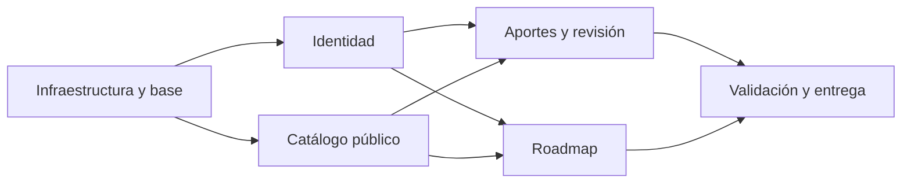

# Implementation Plan — SaberColectivo

Plan de la Instancia B, no ejecución autorizada. Fecha: 27/10/2026. Requiere aprobación docente explícita del usuario antes de crear aplicación, dependencias o contenedores del proyecto. Q-04–06 aún pueden ajustar unicidad, permisos y gestión de publicados; no se ocultan como tareas resueltas.

## 1. MVP — qué es P0

MVP = desde clon limpio, configuración local documentada y `docker compose up --build`, recorrer sin errores de consola:

- US-001 y US-008: catálogo y detalle públicos, búsqueda, categoría y paginación.
- US-002 y US-003: registro, login, logout, recuperación completa por correo con rate limiting y hash seguro.
- US-004, US-005 y US-006: aporte completo, revisión administrativa, rechazo motivado, corrección/reenvío y publicación.
- US-007: único roadmap privado con alta/baja, orden manual y estados pendiente/en_curso/completado.

No incluye pagos, reseñas, valoraciones, comentarios, chat, IA, certificados propios ni correo distinto de recuperación. Certificados del proveedor sí se describen. Una categoría principal por curso, diez iniciales y sin subcategorías.

## 2. Módulos y dependencias (mínimo 4)

El catálogo público no depende del login: su contrato se verifica con fixtures de cursos aprobados. La integración completa usa la publicación de M3, evitando datos de prueba como sustituto de un flujo real. M0 define esquema común; las pruebas se desarrollan con cada módulo, M5 integra y verifica entrega.

## 3. Detalle por módulo

Estimaciones orientativas de esfuerzo individual, no fechas ni compromisos del autor. Incluyen pruebas focalizadas y un margen global adicional, no suponen que todas las tareas se ejecuten simultáneamente.

### M0 — Infraestructura y base

| # | Tarea | Hecho cuando… | Estimación |
|---|---|---|---|
| 0.1 | Resolver y fijar versiones compatibles | Inventario exacto de TRD/SPEC con evidencia; smoke test de React 19, FastAPI y PostgreSQL 18.6, sin tags flotantes. | 2 h |
| 0.2 | Crear estructura de dominios y Compose | Árbol de TRD existe; compose up --build en entorno limpio levanta frontend, backend, postgres y Mailpit; health 200 al conectar BD. | 4 h |
| 0.3 | Migraciones y seeds idempotentes | Constraints de BackendSchema aplican en Postgres real; diez categorías por slug sin duplicados; administrador desde secreto local, nunca rol elegible en registro. | 4 h |
| 0.4 | Shell, tokens y cliente HTTP | Navegación 360/768/1024px, drawer y foco funcionan; envelope único, cookies y CSRF integrados; sin errores de consola. | 4 h |

### M1 — Identidad y recuperación

| # | Tarea | Hecho cuando… | Estimación |
|---|---|---|---|
| 1.1 | Registro y hash Argon2id | Registro con email normalizado; duplicado 409; rol usuario fijo; hash no claro con parámetros TRD; pruebas de límites de entrada. | 3 h |
| 1.2 | Login, sesión, me, logout y CSRF | Cookie segura según entorno; sesión expira a 12h y se revoca; Origin/CSRF inválidos fallan; sesiones ajenas no sirven; UI de ingreso/registro. | 5 h |
| 1.3 | Rate limiting persistido | Login supera umbral → 429 y Retry-After; aplica por IP y email entre workers y tras reinicio; registro y reset con límites documentados. | 3 h |
| 1.4 | Recuperación por SMTP y pantallas | Solicitud genérica; email en Mailpit lleva a restablecer; token 30min/uso único; reset revoca sesiones; dos consumos concurrentes solo uno válido. | 5 h |

### M2 — Catálogo público

| # | Tarea | Hecho cuando… | Estimación |
|---|---|---|---|
| 2.1 | Endpoints públicos y categorías | Solo publicados; paginación uniforme incluso categorías; filtros AND y búsqueda título/tema; 404 para ocultos; total correcto con orden estable. | 3 h |
| 2.2 | Pantallas inicio, catálogo y detalle | UI pública con filtros y query restaurable; badges de certificado/aval; loading, vacío y retry; datos ficticios de prueba identificados. | 4 h |

### M3 — Aportes y revisión

| # | Tarea | Hecho cuando… | Estimación |
|---|---|---|---|
| 3.1 | Alta, listado propio e historial | CursoInput exige metadatos y sí/no explícitos; alta y evento atómicos; datos ajenos 404; eventos y mis aportes paginados. | 4 h |
| 3.2 | Decisión administrativa y concurrencia | Rol comprobado, motivo al rechazar, revision/lock evita doble decisión; publicado visible solo tras aprobar; aplicar respuesta Q-05. | 4 h |
| 3.3 | Corrección y reenvío | Solo autor de rechazado guarda/reenvía; transiciones válidas conservan motivo y snapshots; errores 409/422 no borran datos. | 3 h |
| 3.4 | UI de aporte, estado, corrección y revisión | Formularios y cola conectados; administrador verifica enlace y gratuidad manualmente; todas las rutas APPFlow navegables por teclado. | 5 h |

### M4 — Roadmap privado

| # | Tarea | Hecho cuando… | Estimación |
|---|---|---|---|
| 4.1 | Alta, listado, baja y estados | Solo propietario; un curso una vez; alta publicado al final pendiente; estado persistido; baja no elimina curso y reindexa. | 3 h |
| 4.2 | Movimientos transaccionales | Mover antes de ID o al final funciona entre páginas; dos movimientos concurrentes no duplican posiciones ni pierden ítems; destino ajeno 404. | 3 h |
| 4.3 | Pantalla roadmap y conexión con detalle | Agregar exige confirmación tras login; ordenar con teclado y cruzar página; quitar con modal; estados empty/loading/error y persistencia tras login. | 4 h |

### M5 — Validación y entrega del MVP

| # | Tarea | Hecho cuando… | Estimación |
|---|---|---|---|
| 5.1 | Pruebas integrales y seguridad | US-001–008 de punta a punta pasan; límites, token usado/vencido, permisos cruzados y conflictos cubiertos; no secretos ni stack traces públicos. | 5 h |
| 5.2 | Accesibilidad, paginación y ejecución limpia | Recorrido teclado y zoom 200%; contraste y 320/360/768/1024px; listas >20 elementos; compose desde clon limpio sin errores consola. | 3 h |
| 5.3 | Actualizar evidencia y documentación | TRD con versiones reales, matriz RF/US/pruebas, riesgos y pasos reproducibles; usuario revisa antes de push/merge. | 2 h |

Esfuerzo base estimado: **73 h**. Reserva orientativa del 25%: **18.25 h**; total aproximado **91.25 h**. No se impone fecha de entrega inexistente. Si el tiempo disponible no alcanza, priorizar completar requisitos docentes y consultar alcance, sin eliminar autenticación, recuperación ni revisión. Q-06 puede agregar tareas y aumentar estimación.

## 4. Ejecución (Instancia B)

Un lote coherente por rama y commits convencionales según TRD §4. Ninguna fila está ejecutada. Completar commit real y evidencia al terminar; no colocar hashes de documentación como si implementaran funciones.

| # | Tarea | Módulo | Estado | Rama prevista / Commit |
|---|---|---|---|---|
| 0.1 | Resolver y fijar versiones compatibles | M0 | Pendiente, B no autorizada | chore/infraestructura / sin commit |
| 0.2 | Crear estructura de dominios y Compose | M0 | Pendiente, B no autorizada | chore/infraestructura / sin commit |
| 0.3 | Migraciones y seeds idempotentes | M0 | Pendiente, B no autorizada | chore/infraestructura / sin commit |
| 0.4 | Shell, tokens y cliente HTTP | M0 | Pendiente, B no autorizada | chore/infraestructura / sin commit |
| 1.1 | Registro y hash Argon2id | M1 | Pendiente, B no autorizada | feat/identidad / sin commit |
| 1.2 | Login, sesión, me, logout y CSRF | M1 | Pendiente, B no autorizada | feat/identidad / sin commit |
| 1.3 | Rate limiting persistido | M1 | Pendiente, B no autorizada | feat/identidad / sin commit |
| 1.4 | Recuperación por SMTP y pantallas | M1 | Pendiente, B no autorizada | feat/identidad / sin commit |
| 2.1 | Endpoints públicos y categorías | M2 | Pendiente, B no autorizada | feat/catalogo / sin commit |
| 2.2 | Pantallas inicio, catálogo y detalle | M2 | Pendiente, B no autorizada | feat/catalogo / sin commit |
| 3.1 | Alta, listado propio e historial | M3 | Pendiente, B no autorizada | feat/aportes / sin commit |
| 3.2 | Decisión administrativa y concurrencia | M3 | Pendiente, B no autorizada | feat/aportes / sin commit |
| 3.3 | Corrección y reenvío | M3 | Pendiente, B no autorizada | feat/aportes / sin commit |
| 3.4 | UI de aporte, estado, corrección y revisión | M3 | Pendiente, B no autorizada | feat/aportes / sin commit |
| 4.1 | Alta, listado, baja y estados | M4 | Pendiente, B no autorizada | feat/roadmap / sin commit |
| 4.2 | Movimientos transaccionales | M4 | Pendiente, B no autorizada | feat/roadmap / sin commit |
| 4.3 | Pantalla roadmap y conexión con detalle | M4 | Pendiente, B no autorizada | feat/roadmap / sin commit |
| 5.1 | Pruebas integrales y seguridad | M5 | Pendiente, B no autorizada | test/integracion / sin commit |
| 5.2 | Accesibilidad, paginación y ejecución limpia | M5 | Pendiente, B no autorizada | test/integracion / sin commit |
| 5.3 | Actualizar evidencia y documentación | M5 | Pendiente, B no autorizada | test/integracion / sin commit |

## 5. Estrategia de testing

- Unitarias de reglas puras: campos condicionales de certificado/aval, transición de aporte, formato y normalización URL, estado y reordenamiento de roadmap; patrón AAA, sin HTTP/BD. Objetivo de diseño ≥85% de cobertura de líneas de reglas puras, no de todo el proyecto; cobertura no sustituye casos relevantes.
- Integración contra PostgreSQL 18.6 real aislado, no SQLite: constraints, FK, unique diferible, locks, rollback, dos revisores, dos resets y orden concurrentes; limpiar datos entre casos. ORM y migraciones deben probarse con el mismo motor que se entregará.
- API: pytest y cliente HTTP de FastAPI; 401/403/404/409/422/429, shape de errors, filtros, totales, páginas vacías y máximos. Dos usuarios y administrador con fixtures independientes. Prueba de rate limiting entre procesos/reinicio. Tiempo controlado para expiración sin esperar 30 min reales.
- Frontend: Vitest y Testing Library para formularios, hooks de paginación y sesión, campos asociados, reintento y conflictos; verificar comportamiento observable, sin replicar funciones internas.
- E2E con Playwright: flujos APPFlow 1–5 contra API/BD reales y correo dev capturado; incluir ruta de recuperación y reutilización fallida. No enviar correo real ni usar cursos reales como fixtures.
- Manual: revisión de enlace/gratuidad de un aporte; teclado, foco de drawer/modal, 320/360/768/1024px, zoom 200%, reduced motion, contraste y navegación atrás. No afirmar conformidad de accesibilidad solo con pruebas automáticas.

Cada tarea verifica sus criterios antes de integrarse; M5 ejecuta la regresión completa una vez y se repite solo por cambios o fallos. Reportar comandos, resultados y limitaciones en evidencia de B. En A se revisan documentos, enlaces, secciones de plantillas y contratos: no se corren pruebas de una aplicación inexistente.

## 6. Riesgos del plan

| Riesgo | Impacto | Mitigación |
|---|---|---|
| Aprobación docente o decisiones operativas pendientes | No habilita B / cambios en contrato | Cerrar auditoría y Q-04–06 antes de implementar. |
| Versiones no resueltas | Scaffold no reproducible | 0.1 antes de crear módulos; registrar evidencia real. |
| Esfuerzo mayor al disponible | MVP incompleto | Estimaciones explícitas, reserva y lotes verticales; no ampliar con funciones excluidas. |
| Correo o concurrencia subestimados | Fallos de seguridad | Implementar y probar M1/M3 temprano, antes del pulido final. |
| Formulario extenso y orden entre páginas | Errores UX | Validación compartida conceptualmente y pruebas observables de reenvío/orden. |
| Q-06 agrega gestión administrativa | Cambia API, datos y tareas | Actualizar documentos y estimación tras respuesta, no construir por suposición. |
