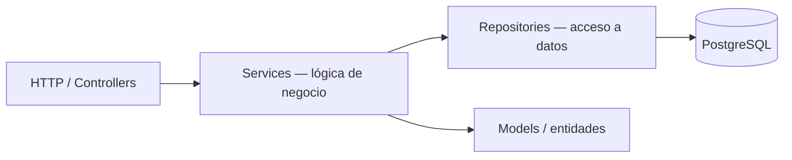
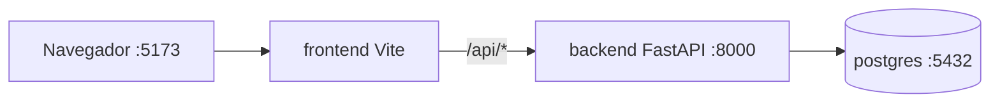

# TRD — Technical Requirements Document — [Nombre del producto]

> **Qué es:** el CÓMO técnico. Decisiones de arquitectura, stack, estructura de carpetas y
> convenciones. No es el plan de tareas (eso es el IMPLEMENTATION_PLAN) ni el producto (PRD).
> **Cuándo está bien:** un developer que no estuvo en la charla puede levantar el proyecto y
> tomar las mismas decisiones que vos; cada decisión importante tiene alternativas, la opción
> elegida y el porqué.

## 1. Stack y versiones exactas

| Capa | Elección | Versión exacta | Por qué |
|------|----------|----------------|---------|
| Frontend | React + Vite + pnpm | [la que instalaste] | [1 línea] |
| Backend | FastAPI + uv | [la que instalaste] | [1 línea] |
| ORM / driver | [SQLModel / SQLAlchemy / psycopg] | | |
| BD | PostgreSQL | [18.6] | fijado por SPEC |
| Infra (dev) | Docker + Compose | | |

## 2. Decisiones técnicas (mínimo 3)

| # | Decisión | Alternativas consideradas | Elegida | Por qué |
|---|----------|---------------------------|---------|---------|
| TD-001 | [ej. estrategia de autenticación] | JWT stateless / sesión server-side / OAuth externo | | |
| TD-002 | [ej. estrategia de paginación] | offset + total / cursor-based | | |
| TD-003 | [ej. formato de errores de API] | envelope propio / RFC 7807 (problem+json) | | |
| TD-004 | [ej. cómo modelar "mi roadmap"] | tabla intermedia con estado / referencia directa | | |

## 3. Arquitectura

### 3.1 Patrón y capas

Screaming Architecture + arquitectura en capas:



- **Controllers:** reciben HTTP, validan input, delegan. Sin lógica de negocio.
- **Services:** reglas de negocio puras y testeables (sin BD, sin HTTP).
- **Repositories:** única puerta a la BD. Sin reglas de negocio.
- **La estructura de carpetas habla del dominio**, no del framework.

### 3.2 Estructura de carpetas (la que se va a crear en la Instancia B)

```
tu-repo/
├── backend/
│   ├── pyproject.toml
│   ├── Dockerfile
│   ├── app/
│   │   ├── main.py
│   │   ├── config.py
│   │   ├── [feature_o_dominio]/        # ej. cursos/, aportes/, roadmap/, identidad/
│   │   │   ├── router.py               # endpoints de esa feature
│   │   │   ├── service.py              # reglas de negocio
│   │   │   ├── repository.py           # acceso a datos
│   │   │   └── models.py               # entidades / schemas
│   │   └── ...
│   └── tests/
├── frontend/
│   ├── package.json
│   ├── Dockerfile
│   └── src/
│       ├── main.jsx
│       ├── app/                        # shell, router, layout global
│       ├── features/                   # ej. catalogo/, aportar/, roadmap/
│       │   └── [feature]/
│       │       ├── components/
│       │       ├── hooks/
│       │       └── api.js
│       └── styles/                     # tokens globales (de UX-UI)
├── docker-compose.yml
└── docs/
```

### 3.3 Servicios Docker (entorno de desarrollo)

| Servicio | Imagen/base | Puerto | Rol |
|----------|-------------|--------|-----|
| postgres | postgres:18.6 | 5432 | base de datos |
| backend | python:3.x-slim + uv | 8000 | API FastAPI (dev) |
| frontend | node:20-alpine + pnpm | 5173 | SPA Vite (dev server) |



> En la clase del 27/10 estos Dockerfiles evolucionan a multi-stage. Por ahora, lo mínimo que levanta.

## 4. Convenciones

- **Commits:** Conventional Commits — `feat:`, `fix:`, `docs:`, `test:`, `refactor:`, `chore:`, `docker:`
- **Flujo de Git:** [completo acá o link a `docs/GIT_WORKFLOW.md`] — ramas, naming, cómo se mergea, quién revisa
- **Errores de API:** [formato elegido + ejemplo JSON]
- **Variables de entorno:**

  | Variable | Ejemplo | Obligatoria | Descripción |
  |----------|---------|-------------|-------------|
  | DATABASE_URL | postgresql://…@postgres:5432/… | sí | |
  | | | | |

- **Logging y excepciones:** [2 a 4 líneas: qué se loggea, dónde se capturan las excepciones]

## 5. Requisitos no funcionales técnicos (traducción de las restricciones)

| Restricción (SPEC) | Cómo se cumple | Dónde se verifica |
|--------------------|----------------|-------------------|
| Paginación de listados | [decisión TD-002] | [ej. GET /api/v1/cursos?page=…] |
| Mobile-first con mejora progresiva | tokens + breakpoints documentados en UX-UI §3 | [componentes críticos] |
| Menú sándwich | componente Header con ARIA | [APPFlow §3] |
| Screaming Architecture | árbol §3.2 | [revisión del repo] |

## 6. Riesgos técnicos

| Riesgo | Probabilidad | Impacto | Mitigación |
|--------|--------------|---------|------------|
| [ej. scraping/validación de URLs externas más compleja de lo estimado] | media | medio | [mitigación] |
| | | | |

---

**Referencia:**
- Design Docs at Google (el clásico de los design docs, con énfasis en trade-offs):
  https://www.industrialempathy.com/posts/design-docs-at-google/
