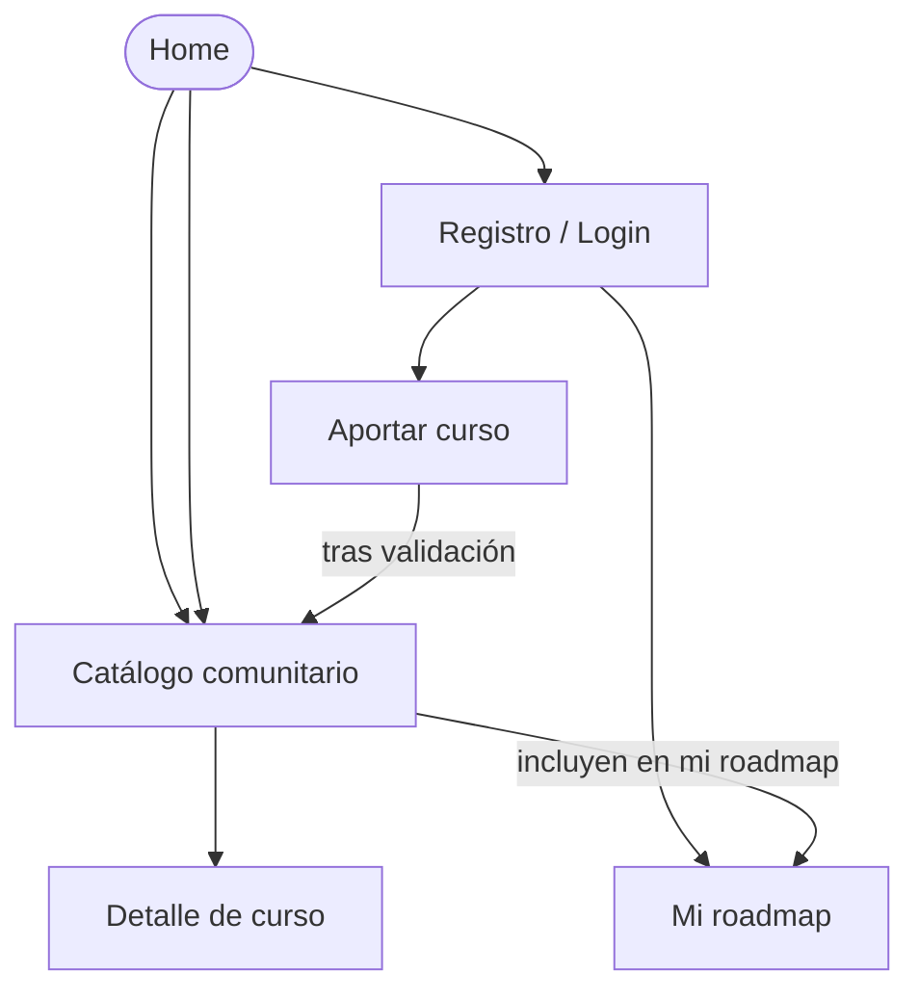

# APPFlow — Mapa del sitio y flujos de usuario — [Nombre del producto]

> **Qué es:** el esqueleto de navegación. Sitemap (todas las pantallas y sus rutas), ficha por
> pantalla y flujos de usuario extremo a extremo. Es el puente entre el PRD (qué quiere el usuario)
> y el BackendSchema (qué API lo sostiene).
> **Cuándo está bien:** se puede recorrer el producto entero en papel antes de escribir una línea
> de React; cada pantalla sabe qué API consume, y esas APIs existen en el BackendSchema;
> no hay ninguna pantalla "colgada" sin ruta ni ningún flujo sin pantallas.

## 1. Sitemap

## 2. Rutas

| Ruta | Pantalla | Requiere login | Notas |
|------|----------|----------------|-------|
| `/` | Home | no | [qué muestra] |
| `/catalogo` | Catálogo comunitario (paginado) | no | filtros: [...] |
| `/catalogo/:id` | Detalle de curso | no | |
| `/roadmap` | Mi roadmap | sí | redirect a `/login` si no hay sesión |
| `/aportar` | Formulario de aporte | sí | |
| `/aportar/:id/estado` | Estado de mi aporte | sí | [si aplica] |
| `/login`, `/registro` | Autenticación | no | |
| `/validar` | Panel de validación | sí (rol) | [si tu decisión de producto incluye validación explícita] |
| … | | | |

## 3. Fichas de pantalla

> Una por cada pantalla del sitemap.

### Pantalla: Catálogo comunitario (`/catalogo`)

- **Objetivo del usuario:** [1 línea]
- **Componentes (de la UX-UI):** header, filtros/búsqueda, grid de cards, paginador, empty state, skeleton
- **Estados:** `loading` (skeleton) · `ok` · `empty` (sin resultados) · `error` (retry)
- **APIs que consume:** `GET /api/v1/cursos?page=…&page_size=…&categoria=…&q=…` → ver BackendSchema §3.2
- **Navegación:** desde Home/menú; hacia Detalle de curso; al aportar (CTA)

### Pantalla: Detalle de curso (`/catalogo/:id`)

- [...]

### Pantalla: Aportar curso (`/aportar`)

- [...]

### Pantalla: Mi roadmap (`/roadmap`)

- [...]

[...una ficha por cada pantalla del sitemap]

## 4. Flujos de usuario (mínimo 3)

> Pasos numerados de punta a punta, incluyendo validaciones, errores y ramas alternativas.

### Flujo 1 — Aportar un curso al catálogo

1. Usuario logueado presiona "Aportar curso" (menú/header)
2. Llega a `/aportar`; el formulario pide: URL activa, categoría (lista), tema, título, versión, año, docentes, flags (cuestionarios / examen / certificado / aval), y la declaración "yo tomé este curso"
3. Validaciones en línea: [campos obligatorios, formato de URL, duplicado]
4. Submit → `POST /api/v1/aportes` → 201 con estado `en_revision`
5. Toast de confirmación + redirección a "estado de mi aporte"
6. **Rama de error:** validación fallida → mensajes inline, nada se pierde; error de red → toast de error + reintentar

### Flujo 2 — Descubrir un curso y agregarlo a mi roadmap

1. [...]

### Flujo 3 — Validación de un aporte (según tu decisión de producto)

1. [...]

### Flujo 4 (opcional) — Registro y primeros pasos

1. [...]

## 5. Estados globales de la app

| Situación | Comportamiento |
|-----------|----------------|
| Sin sesión y ruta protegida | redirect a `/login` con retorno a la ruta original |
| Sesión expirada | [decisión: toast + logout + redirect] |
| Error de red global | [decisión: banner / retry] |

---

**Referencias:**
- NN/g — Information Architecture vs. Sitemaps: https://www.nngroup.com/articles/information-architecture-sitemaps/
- NN/g — User Journeys vs. User Flows: https://www.nngroup.com/articles/user-journeys-vs-user-flows/
