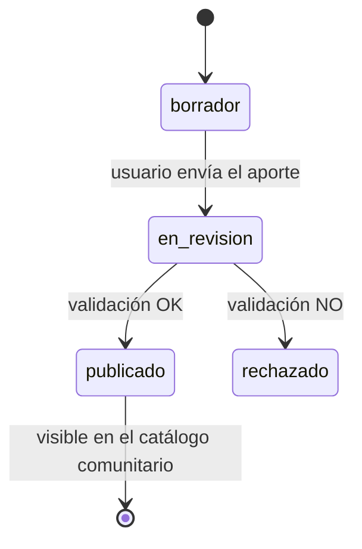

# BackendSchema — Esquema de base de datos y APIs — [Nombre del producto]

> **Qué es:** el contrato del backend: modelo de datos en PostgreSQL + superficie de API REST.
> Es lo que hace posible el TRD y lo que consume el APPFlow.
> **Cuándo está bien:** con este documento se puede crear la base de datos y escribir los tests
> de integración sin tomar decisiones de diseño pendientes; todo endpoint que aparece en el
> APPFlow existe acá con sus respuestas y errores; los estados del curso están modelados.

## 1. Modelo de datos

### 1.1 Diagrama entidad-relación (Mermaid — se renderiza en GitHub)

```mermaid
erDiagram
    USUARIO ||--o{ APORTA : realiza
    USUARIO ||--o{ ROADMAP_ITEM : organiza
    CURSO ||--o{ ROADMAP_ITEM : contiene
    CATEGORIA ||--o{ CURSO : clasifica
    APORTA }o--|| CURSO : referencia

    USUARIO {
        serial id PK
        varchar email UK
        varchar password_hash
        varchar nombre
        timestamptz creado_en
    }
    CURSO {
        serial id PK
        varchar url
        varchar titulo
        varchar tema
        varchar version
        int anio_edicion
        boolean tiene_cuestionarios
        boolean requiere_examen
        boolean extiende_certificado
        varchar aval_organizacion
        enum estado
        int categoria_id FK
    }
    /* completar con tus entidades reales */
```

### 1.2 Tablas (una por entidad)

#### `usuarios`

| Columna | Tipo | Constraints | Notas |
|---------|------|-------------|-------|
| id | serial / uuid | PK | |
| email | varchar(255) | UNIQUE NOT NULL | identificador de login |
| password_hash | varchar | NOT NULL | nunca la contraseña en claro |
| … | | | |

**Índices:** [los que hagan falta, con justificación]

#### `cursos`

| Columna | Tipo | Constraints | Notas |
|---------|------|-------------|-------|
| id | serial / uuid | PK | |
| url | varchar(2048) | NOT NULL, UNIQUE | enlace web activo del curso |
| titulo | varchar(200) | NOT NULL | |
| categoria_id | int | FK → categorias, NOT NULL | lista cerrada |
| estado | enum(estado_curso) | NOT NULL, default 'borrador' | ver §2 |
| … | | | |

[una tabla por cada entidad de tu erDiagram]

## 2. Estados del ciclo de vida del curso



| Estado | Quién lo ve | Qué puede pasar |
|--------|-------------|-----------------|
| borrador | solo el autor | editar, enviar a revisión |
| en_revision | autor + rol validador | validar / rechazar |
| publicado | todos | incluir en mi roadmap |
| rechazado | autor + rol validador | ver motivo; re-enviar (si aplica) |

## 3. API REST

**Convención general:**

- Prefijo: `/api/v1`
- Paginación: offset — `?page=1&page_size=20` con respuesta `{ "items": [...], "total": N, "page": n, "page_size": n }`
  (o la estrategia que hayas elegido en el TRD TD-002 — mantené una sola)
- Errores: [envelope elegido en TRD TD-003] — `{ "error": { "code": "...", "message": "..." } }`
- Timestamps en ISO 8601 UTC

### 3.1 Autenticación

| Método | Path | Auth | Request | Respuestas |
|--------|------|------|---------|------------|
| POST | `/api/v1/auth/registro` | pública | `{ "email": "...", "password": "...", "nombre": "..." }` | 201 `{…}` · 409 email duplicado · 422 validación |
| POST | `/api/v1/auth/login` | pública | `{ "email": "...", "password": "..." }` | 200 token/sesión · 401 credenciales |
| POST | `/api/v1/auth/logout` | sesión | — | 204 |

### 3.2 Catálogo de cursos

| Método | Path | Auth | Query / Request | Respuestas |
|--------|------|------|-----------------|------------|
| GET | `/api/v1/cursos` | pública | `page`, `page_size`, `categoria`, `q` | 200 paginado · 422 |
| GET | `/api/v1/cursos/{id}` | pública | — | 200 · 404 |

Ejemplo `GET /api/v1/cursos?page=1&page_size=2` → 200:

```json
{
  "items": [
    { "id": 1, "titulo": "...", "categoria": {"id": 3, "nombre": "..."}, "estado": "publicado" }
  ],
  "total": 47,
  "page": 1,
  "page_size": 2
}
```

### 3.3 Aportes de cursos y validación

| Método | Path | Auth | Request | Respuestas |
|--------|------|------|---------|------------|
| POST | `/api/v1/aportes` | sesión | { todos los campos del aporte + `declare_que_lo_tomo` } | 201 en_revision · 409 duplicado · 422 |
| GET | `/api/v1/aportes/{id}` | sesión (autor) | — | 200 · 403 · 404 |
| POST | `/api/v1/aportes/{id}/validar` | sesión (rol validador) | `{ "aprobado": true }` | 200 · 403 |

### 3.4 Roadmap del usuario

| Método | Path | Auth | Request | Respuestas |
|--------|------|------|---------|------------|
| GET | `/api/v1/roadmap` | sesión | `page`, `page_size` | 200 paginado |
| POST | `/api/v1/roadmap/items` | sesión | `{ "curso_id": 1, "orden": 1 }` | 201 · 409 ya incluido · 404 curso inexistente/no publicado |
| DELETE | `/api/v1/roadmap/items/{id}` | sesión | — | 204 · 404 |

### 3.5 Categorías (lista cerrada)

| Método | Path | Auth | Respuestas |
|--------|------|------|------------|
| GET | `/api/v1/categorias` | pública | 200 lista completa |

## 4. Decisiones del esquema

| Decisión | Alternativas | Por qué |
|----------|--------------|---------|
| [ej. categorías como tabla FK vs enum en Postgres] | | |
| [ej. roadmap como tabla intermedia usuario-curso con `orden`] | | |
| [ej. campos de certificado/examen como booleanos vs flags JSONB] | | |

---

**Referencias:**
- Mermaid — Entity Relationship Diagrams: https://mermaid.js.org/syntax/entityRelationshipDiagram.html
- PostgreSQL — The Conceptual Model (tablas, constraints, índices): https://www.postgresql.org/docs/current/datamodel.html
