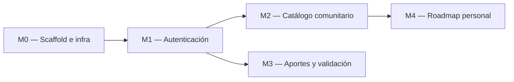

# Implementation Plan — [Nombre del producto]

> **Qué es:** el orden de construcción. Módulos, dependencias, tareas con su definición de hecho
> y estimaciones. Es lo que ejecutás en la Instancia B, tarea por tarea, rama por rama.
> **Cuándo está bien:** cada tarea tiene un "hecho" verificable sin interpretaciones; el orden
> respeta dependencias reales; el MVP está definido sin ambigüedades — se puede responder
> con un sí o un no a la pregunta "¿el lunes a la noche funciona esto?".

## 1. MVP — qué es P0

> Criterio de MVP: en una máquina limpia, `docker compose up` y recorrer end-to-end las
> siguientes historias del PRD, sin errores en consola:

- US-00x: [historia del PRD]
- US-00y: [...]
- US-00z: [...]

## 2. Módulos y dependencias (mínimo 4)

> [Ajustá el grafo a tu PRD y tu TRD. Las flechas son dependencias reales:
> no podés probar el catálogo sin el scaffold, no podés aportar sin sesión, etc.]

## 3. Detalle por módulo

### M0 — Scaffold e infraestructura

| # | Tarea | Hecho cuando… | Estimación |
|---|-------|----------------|------------|
| 0.1 | Estructura de carpetas del TRD §3.2 | el árbol existe en el repo, vacío pero correcto | 30 min |
| 0.2 | `docker-compose.yml` con postgres 18.6 | `docker compose up postgres` levanta y acepta conexiones | 45 min |
| 0.3 | Backend FastAPI mínimo con `GET /health` | `curl localhost:8000/health` responde 200 | 1 h |
| 0.4 | Frontend Vite + React 19 con shell (header + router) | `pnpm dev` muestra el shell navegable | 1 h |

### M1 — Autenticación

| # | Tarea | Hecho cuando… | Estimación |
|---|-------|----------------|------------|
| 1.1 | [...] | [verificable con un comando o una acción en la UI] | |

### M2 — Catálogo comunitario

| # | Tarea | Hecho cuando… | Estimación |
|---|-------|----------------|------------|
| 2.1 | Seed de categorías y cursos de prueba | hay datos al levantar | |
| 2.2 | `GET /api/v1/cursos` paginado + filtros | [...] | |
| 2.3 | Pantalla de catálogo con cards y paginador | [...] | |

### M3 — Aportes y ciclo de validación

[tabla igual]

### M4 — Roadmap personal

[tabla igual]

## 4. Ejecución (Instancia B)

> **Regla:** 1 tarea (o lote coherente) = rama según tu flujo documentado + Commits convencionales.
> Actualizá esta tabla mientras avanzás.

| # | Tarea | Módulo | Estado | Rama / Commit |
|---|-------|--------|--------|---------------|
| 0.1 | Estructura de carpetas | M0 | [ ] | |
| 0.2 | docker-compose postgres | M0 | [ ] | |
| … | | | | |

## 5. Estrategia de testing

> Se **planificá** acá y se **implementa** en la clase del 27/10.

- **Unit tests (services):** funciones puras de negocio — ej. reglas de validación de aportes,
  reglas del roadmap, transiciones de estado del curso. Patrón AAA, sin BD ni HTTP.
- **Integration tests (repositories/services):** contra BD real (SQLite en memoria o Postgres del compose).
- **Frontend:** hooks con Vitest (estado de carga, paginación, errores).
- Objetivo de cobertura: [declará el tuyo — ej. ≥ 85% en services]

## 6. Riesgos del plan

| Riesgo | Impacto | Mitigación |
|--------|---------|------------|
| [ej. el formulario de aporte tiene 12 campos: validarlos todo bien lleva más de lo estimado] | | [ej. modelar schema de validación único compartido] |
| | | |

---

**Referencias:**
- Atlassian — Plantilla de plan de proyecto: https://www.atlassian.com/software/confluence/templates/project-plan
- Shape Up — cómo partir trabajo real en scopes cerrables: https://basecamp.com/shapeup/
